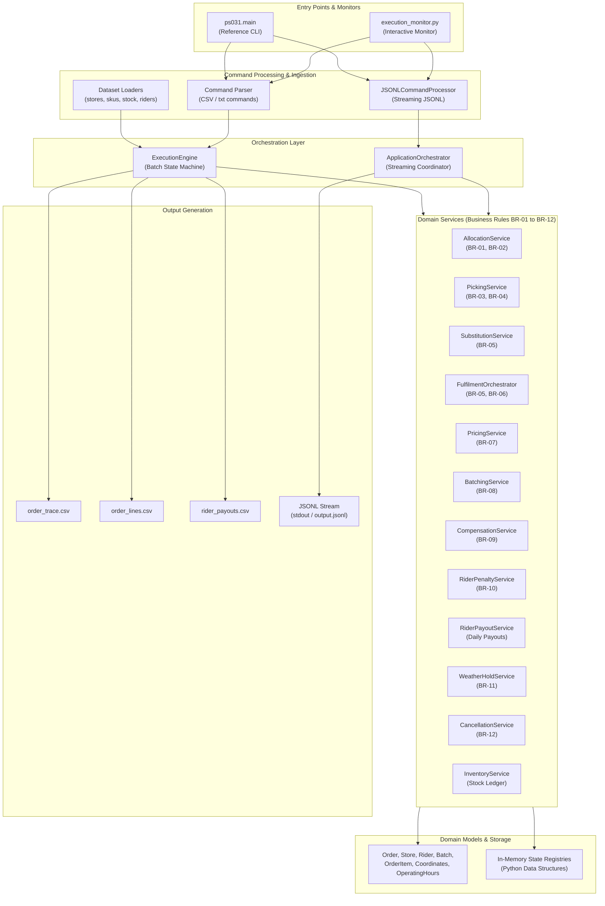

# PS-031 Quick Commerce Engine

A high-performance, zero-dependency Python simulation and dispatch engine designed for dark-store order fulfillment, picking scheduling, inventory management, multi-order rider batching, and dynamic delivery dispatch under a strict 10-minute Service Level Agreement (SLA).

[](https://www.python.org/downloads/)
[](#15-testing-and-verification)
[](#6-technology-stack)
[](#17-team-and-project-information)

---

## Table of Contents

1. [Project Overview](#1-project-overview)
2. [Problem Statement](#2-problem-statement)
3. [Project Objectives](#3-project-objectives)
4. [Key Features](#4-key-features)
5. [System Architecture](#5-system-architecture)
6. [Technology Stack](#6-technology-stack)
7. [Repository Structure](#7-repository-structure)
8. [Prerequisites](#8-prerequisites)
9. [Installation and Setup](#9-installation-and-setup)
10. [Input Data and File Formats](#10-input-data-and-file-formats)
11. [Running the Project](#11-running-the-project)
    - [Option A: Standalone Execution Monitor (Recommended)](#option-a-standalone-execution-monitor-recommended)
    - [Option B: Original Reference CLI](#option-b-original-reference-cli)
    - [Option C: JSONL Streaming Pipeline](#option-c-jsonl-streaming-pipeline)
12. [Understanding Execution Output](#12-understanding-execution-output)
13. [Generated Output Files](#13-generated-output-files)
14. [Business Rules and Processing Workflow](#14-business-rules-and-processing-workflow)
15. [Testing and Verification](#15-testing-and-verification)
16. [Limitations and Known Caveats](#16-limitations-and-known-caveats)
17. [Team and Project Information](#17-team-and-project-information)

---

## 1. Project Overview

The **PS-031 Quick Commerce Engine** is an end-to-end event-driven fulfillment platform tailored for rapid hyperlocal grocery delivery. The system models the complete lifecycle of incoming customer orders across a network of micro-fulfillment centers (dark stores):

```
Order Placement ➔ Store Allocation ➔ Stock Reservation ➔ Picking Slot Scheduling ➔
Picking & Packaging ➔ Rider Batching & Dispatch ➔ Real-Time Delivery ➔ SLA & Compensation Audit
```

The system operates deterministically in two execution modes:
1. **CSV Batch Simulation Mode:** Processes sequential operational command files (`commands.txt`) alongside catalog datasets to evaluate multi-store dark-store operations, producing regulatory and audit CSV reports.
2. **JSONL Streaming Mode:** A headless stream processor communicating via standard I/O (`stdin`/`stdout`), parsing line-delimited JSON envelopes for low-latency command execution and real-time trace inspection.

---

## 2. Problem Statement

Hyperlocal quick commerce demands the delivery of groceries and household essentials within 10 to 15 minutes of order placement. Achieving this SLA at scale requires solving high-concurrency logistical challenges:

- **Hyperlocal Dark Store Allocation:** Selecting the optimal fulfillment store within a tight 3.00 km radius based on real-time line-fill availability, road travel proximity, and picker workload.
- **Micro-Warehouse Bottlenecks:** Managing warehouse picking queues divided into discrete clock-aligned time windows without overflowing physical staging limits.
- **Stockouts and Partial Fulfillments:** Mitigating stock depletion dynamically via automated item substitutions while protecting customers from price increases.
- **Rider Utilization & Unit Economics:** Combining up to two orders heading to nearby delivery coordinates ($\le 1.00\text{ km}$ apart) into a single batch without delaying either drop-off.
- **Service Disruptions & Lateness:** Enforcing automated customer compensation (wallet credits and discount coupons) when SLAs are breached, managing temporary weather holds, and maintaining fair, transparent rider earnings and penalties.

---

## 3. Project Objectives

- Implement an autonomous dispatch engine enforcing all 12 core quick-commerce business rules (**BR-01** through **BR-12**).
- Maintain deterministic, reproducible order allocation across competing dark stores.
- Guarantee exact monetary arithmetic across all financial transactions using fixed-point `Decimal` representation.
- Deliver a zero-external-runtime-dependency architecture implemented purely on Python 3.11's standard library.
- Provide full observability into execution progress via both machine-parseable outputs and real-time terminal telemetry.

---

## 4. Key Features

- **Multi-Store Hyperlocal Allocation:** Dynamic Haversine distance computation ($R = 6371.0\text{ km}$) with store operating hours validation and weather hold isolation.
- **Capacity-Constrained Picking Scheduler:** Rolling 10-minute clock-aligned slots with automated overflow cascading when store picking limits are reached.
- **Customer-Centric Substitution Engine:** Support for `ALLOW`, `SIMILAR_ONLY`, and `NONE` customer policies with strict price protection (the customer is never charged more than the original SKU price).
- **60% Fulfillment Threshold Gate:** Automated order cancellation with complete customer refund if a store cannot fulfill at least 60% of the requested order value.
- **Dynamic Pricing & Surge Protection:** Delivery fees calculated based on basket size (free delivery for orders $\ge ₹199$) and localized dark-store demand surge ratios, frozen permanently at allocation.
- **Multi-Order Proximity Batching:** Batch creation grouping up to 2 orders from the same dark store with customer drop points within $1.00\text{ km}$, dispatched after a 3-minute aggregation window.
- **Automated SLA Compensation & Rider Audit:** Automatic issuance of ₹25 wallet credit and ₹50 promo coupon on deliveries exceeding ETA + 5 minutes, paired with capped rider disciplinary deductions and transparent daily payout summaries.
- **Dual CLI & Execution Monitoring:** Includes both the reference CLI (`ps031.main`) and an enhanced real-time terminal monitor (`execution_monitor.py`) featuring ANSI styling, stage profiling, and 100% output parity.

---

## 5. System Architecture

The project follows a layered domain-driven architecture with clean separation between models, domain services, orchestration workflows, and command-line interfaces:



---

## 6. Technology Stack

| Component | Technology | Version | Description |
| :--- | :--- | :--- | :--- |
| **Language** | Python | `3.11+` (tested on `3.11.15`) | Primary programming language |
| **Runtime Dependencies** | None | Standard Library | **Zero third-party packages required** for production code |
| **Financial Arithmetic** | `decimal.Decimal` | Built-in | Exact fixed-point math preventing float rounding errors |
| **Data Modeling** | `dataclasses`, `enum` | Built-in | Strongly typed domain entities and state machines |
| **Spatial Calculations** | `math` | Built-in | Trigonometric spherical Haversine distance computations |
| **Data Formats** | `csv`, `json` | Built-in | Ingestion and export of RFC-compliant CSV and JSON Lines |
| **CLI Dispatch** | `argparse` | Built-in | Robust argument parsing and flag validation |
| **Test Framework** | `pytest` | `9.1.1` | Automated test runner, parameterization, and fixtures |

---

## 7. Repository Structure

```text
ps031-quick-commerce/
├── data/                               # Default simulation datasets
│   ├── commands.txt                    # Sequential simulation command script
│   ├── delivery_events.csv             # In-flight delivery timestamp events
│   ├── riders.csv                      # Registered delivery rider roster
│   ├── skus.csv                        # Product catalog with MRP & categories
│   ├── stock.csv                       # Store inventory stock levels
│   └── stores.csv                      # Dark store locations & operating hours
├── docs/                               # Architecture and specification records
│   ├── design-document.md              # Technical design document
│   └── glossary.md                     # Domain vocabulary and definitions
├── examples/
│   └── happy_path.jsonl                # 11-command end-to-end streaming walkthrough
├── src/
│   └── ps031/                          # Core engine package
│       ├── __init__.py                 # Package declaration
│       ├── command_parser.py           # Text command parsing (CSV mode)
│       ├── command_processor.py        # JSONL streaming command dispatcher
│       ├── execution_engine.py         # Batch simulation state machine
│       ├── loaders.py                  # CSV file loaders and schema validators
│       ├── main.py                     # Unified CLI entry point
│       ├── orchestrator.py             # Application orchestrator (JSONL stream)
│       ├── models/                     # Core domain entities
│       │   ├── batch.py                # Batch model & BatchStatus enum
│       │   ├── coordinates.py          # Lat/Lng spatial representation
│       │   ├── operating_hours.py      # Store operating window model
│       │   ├── order.py                # Order, OrderItem, & financial fields
│       │   ├── order_state.py          # Lifecycle OrderState state machine
│       │   ├── rider.py                # Rider profile & availability model
│       │   └── store.py                # Store profile & picking capacity
│       ├── services/                   # Business rule services (BR-01 to BR-12)
│       │   ├── allocation_service.py   # Store eligibility & selection (BR-01, BR-02)
│       │   ├── batching_service.py     # Rider batch formation & sequence (BR-08)
│       │   ├── cancellation_service.py # Customer cancellations & refunds (BR-12)
│       │   ├── compensation_service.py # SLA lateness compensation (BR-09)
│       │   ├── inventory_service.py    # Atomic inventory reservations
│       │   ├── picking_service.py      # Picking slot scheduling & ETA (BR-03, BR-04)
│       │   ├── pricing_service.py      # Delivery & surge fee computation (BR-07)
│       │   ├── rider_payout_service.py # Daily rider payout calculation
│       │   ├── rider_penalty_service.py# Lateness deductions & caps (BR-10)
│       │   ├── substitution_service.py # SKU shortfall resolution (BR-05)
│       │   └── weather_hold_service.py # Adverse weather store holds (BR-11)
│       └── utils/
│           ├── distance.py             # Haversine distance formula
│           └── time_utils.py           # Clock arithmetic & interval utilities
├── tests/                              # Automated test suite (1,133 tests)
│   ├── test_allocation.py              # Store allocation unit tests
│   ├── test_batching.py                # Batching and proximity tests
│   ├── test_cancellation.py            # Cancellation fee tier tests
│   ├── test_execution_monitor.py       # Execution monitor integration tests
│   ├── test_happy_path.py              # End-to-end JSONL scenario tests
│   ├── test_pricing.py                 # Delivery and surge pricing tests
│   └── ...                             # Additional service and unit tests
├── execution_monitor.py                # Standalone real-time execution monitor
├── PROJECT_DECISIONS.md                # Architecture and business decisions record
├── pyproject.toml                      # Pytest and project build configuration
├── requirements.txt                    # Development dependencies (pytest)
├── TECH_STACK.md                       # Comprehensive technology stack audit
└── README.md                           # Project documentation (this file)
```

---

## 8. Prerequisites

- **Operating System:** Windows 10/11, macOS, or Linux.
- **Python:** Version `3.10` or higher (`3.11.15` recommended).
- **Shell:** Windows PowerShell (examples below) or Bash/Zsh.
- **Git:** For repository cloning and branch navigation.

---

## 9. Installation and Setup

### 1. Clone the Repository
```powershell
git clone <repository-url>
cd ps031-quick-commerce
```

### 2. Create and Activate a Virtual Environment
Using PowerShell on Windows:
```powershell
python -m venv .venv
.\.venv\Scripts\Activate.ps1
```

*(On Linux / macOS, use: `python3 -m venv .venv && source .venv/bin/activate`)*

### 3. Install Development Dependencies
```powershell
pip install -r requirements.txt
```

### 4. Configure `PYTHONPATH`
To allow Python to discover the `ps031` package without requiring an editable install:
```powershell
$env:PYTHONPATH = "src"
```

*(On Linux / macOS: `export PYTHONPATH="src"`)*

---

## 10. Input Data and File Formats

The simulation relies on structured CSV and command files placed in the data directory:

### 1. `stores.csv`
Defines dark store facilities, geographic coordinates, operating windows, and picking capacity.
```csv
store_id,store_name,latitude,longitude,open_time,close_time,picking_capacity
DS-01,Indiranagar Dark Store,12.971598,77.641200,06:00:00,23:00:00,12
DS-02,Koramangala Dark Store,12.935242,77.624462,07:00:00,22:00:00,12
```

### 2. `skus.csv`
Product catalog detailing SKU codes, category taxonomy, and unit prices.
```csv
sku,name,category,sub_category,price
SKU-001,Organic Whole Milk 1L,Dairy,Milk,65.00
SKU-002,Farm Fresh Eggs 6pk,Dairy,Eggs,55.00
```

### 3. `stock.csv`
Per-store inventory ledger mapping available quantities of each SKU.
```csv
store_id,sku,quantity
DS-01,SKU-001,50
DS-01,SKU-002,30
```

### 4. `riders.csv`
Registered delivery personnel and their assigned home dark store.
```csv
rider_id,rider_name,home_store_id
RDR-01,Arun Kumar,DS-01
RDR-02,Bhavesh Patel,DS-02
```

### 5. `delivery_events.csv`
Actual physical delivery confirmation timestamps captured from mobile rider telemetry.
```csv
order_id,delivered_time
ORD-0001,2026-10-16 18:22:15
ORD-0002,2026-10-16 18:24:30
```

### 6. `commands.txt`
Pipe-delimited command stream driving sequential simulation actions:
```text
RIDERS|2026-10-16 18:00:00|DS-03|2
ORDER|ORD-0001|2026-10-16 18:00:05|CUS-1001|12.961500|77.632100|ALLOW|false|SKU-001:2,SKU-005:1
CANCEL|ORD-0004|2026-10-16 18:31:00|CUSTOMER_MISTAKE
WEATHER_HOLD|2026-10-16 19:12:00|2026-10-16 19:32:00|DS-02|HEAVY_RAIN
LOAD_DELIVERIES|delivery_events.csv
PRINT_TRACE|ORD-0001
PRINT_RIDER_PAYOUTS|2026-10-16
```

---

## 11. Running the Project

The engine supports multiple execution methods depending on your requirements.

### Option A: Standalone Execution Monitor (Recommended)

`execution_monitor.py` wraps the engine with real-time console feedback, ANSI stage indicators, command profiling, and execution summaries.

#### CSV Batch Simulation Mode
Run against the default `data/` directory:
```powershell
$env:PYTHONPATH = "src"
python execution_monitor.py --data-dir data --commands data/commands.txt --output-dir output
```

*Note: For convenience in CSV mode, the monitor also supports `-o` as an alias for `--output-dir`:*
```powershell
python execution_monitor.py --data-dir data --commands data/commands.txt -o output
```

To run against an external dataset path (such as the verified sample data):
```powershell
$dataDir = "C:\Users\panna\Desktop\pers\capstone\T027-PS-031-sample-data"
python execution_monitor.py --data-dir $dataDir --commands "$dataDir\commands.txt" -o output
```

---

### Option B: Original Reference CLI

The standard headless engine (`src/ps031/main.py`) provides minimal terminal output and writes directly to files.

#### CSV Batch Simulation Mode
*Note: In the original CLI, `--output-dir` is strictly required for CSV simulation mode. Do not use `-o` as an output directory flag here, as `-o` is reserved exclusively for the JSONL stream output file.*

```powershell
$env:PYTHONPATH = "src"
python -m ps031.main --data-dir data --commands data/commands.txt --output-dir output
```

---

### Option C: JSONL Streaming Pipeline

Both `ps031.main` and `execution_monitor.py` support line-delimited JSONL stream execution.

#### Running the Sample Walkthrough
Process the provided end-to-end example (`examples/happy_path.jsonl`):

```powershell
$env:PYTHONPATH = "src"
python -m ps031.main examples/happy_path.jsonl -o output.jsonl
```

Or using the execution monitor (which writes serialized JSONL to `output.jsonl` and emits real-time progress to `stderr`):
```powershell
python execution_monitor.py examples/happy_path.jsonl -o output.jsonl
```

#### Running via Standard Input / Output (Unix-style Pipe)
```powershell
Get-Content examples/happy_path.jsonl | python -m ps031.main > output.jsonl
```

#### Inspecting JSONL Stream Results
```powershell
Get-Content output.jsonl | ForEach-Object { $_ | ConvertFrom-Json } | Select-Object line_number, command, status
```

---

## 12. Understanding Execution Output

### Console Output (Execution Monitor)

When running `execution_monitor.py`, progress is organized into five structured phases:

```text
=======================================================
          QUICK COMMERCE ORDER PROCESSING
                    TEAM T027
=======================================================

DATASET INITIALIZATION
----------------------------------------
[1] Loading stores.csv
    ✓ Successfully loaded 4 stores.
[2] Loading skus.csv
    ✓ Successfully loaded 40 SKUs.
[3] Loading stock.csv
    ✓ Successfully loaded 160 stock records.
[4] Loading riders.csv
    ✓ Successfully loaded 15 riders.
[5] Parsing commands.txt
    ✓ Successfully parsed 130 commands.

----------------------------------------
          COMMAND EXECUTION
----------------------------------------
[  1/130] RIDERS       | Store DS-03 active riders -> 2
[  2/130] ORDER        | ORD-0001 -> ALLOCATED to DS-01 (1.81 km) | ETA: 18:09:30 | Fee: ₹25.00
[  3/130] ORDER        | ORD-0001 -> ALLOCATED to DS-01 (1.81 km) | ETA: 18:09:30 | Fee: ₹25.00
[  4/130] ORDER        | ORD-0002 -> ALLOCATED to DS-03 (0.32 km) | ETA: 18:13:59 | Fee: ₹15.00 (SURGE)
...
[ 69/130] LOAD_DELIVERIES | Loaded 55 actual delivery events from delivery_events.csv
[ 70/130] PRINT_TRACE  | Generated trace record for ORD-0001
...
[130/130] PRINT_RIDER_PAYOUTS | Generated rider payout audit rows for 2026-10-16

REPORT GENERATION
----------------------------------------
  ✓ order_trace.csv   :  60 rows -> output\order_trace.csv
  ✓ order_lines.csv   : 124 rows -> output\order_lines.csv
  ✓ rider_payouts.csv :  15 rows -> output\rider_payouts.csv

=======================================================
                 EXECUTION SUMMARY
=======================================================
  Total commands processed : 130
  Orders received          : 61
  Orders allocated         : 59
  Orders rejected          : 2
  Cancellations handled    : 3
  Weather holds activated  : 1
  Delivery events loaded   : 55
  Simulation runtime       : 0.09 seconds
  Execution status         : SUCCESS (All reports verified)
=======================================================
```

### Stream Invariant in JSONL Mode
In JSONL streaming mode, `execution_monitor.py` guarantees strict I/O stream separation:
- **`stdout` (or `-o file.jsonl`):** Contains **only** valid, machine-readable JSONL envelopes.
- **`stderr`:** Contains **all** human-readable diagnostic messages, styling codes, and summaries.

---

## 13. Generated Output Files

In CSV simulation mode, three CSV audit files are exported to the target directory:

### 1. `order_trace.csv`
Lifecycle audit log for every order submitted to the system.
- **Key Columns:** `order_id`, `customer_id`, `store_id`, `status`, `order_value`, `delivery_fee`, `surge_fee`, `cancellation_fee`, `refund_amount`, `estimated_delivery_time`, `actual_delivery_time`, `sla_breached`, `compensation_coupon`, `compensation_wallet`.
- **Verified Sample Count:** 60 rows (59 allocated orders + 1 rejected order with logged trace).

### 2. `order_lines.csv`
Detailed fulfillment breakdown for every individual item requested in an order.
- **Key Columns:** `order_id`, `requested_sku`, `requested_quantity`, `fulfilled_sku`, `fulfilled_quantity`, `unit_price`, `total_price`, `was_substituted`, `substitution_policy`.
- **Verified Sample Count:** 124 rows representing individual item fulfillment decisions across all orders.

### 3. `rider_payouts.csv`
Daily financial settlement ledger for active delivery personnel.
- **Key Columns:** `rider_id`, `date`, `deliveries_completed`, `base_pay`, `batch_bonuses`, `penalties`, `total_payout`.
- **Verified Sample Count:** 15 rows (one settlement row per registered rider).

---

## 14. Business Rules and Processing Workflow

The platform strictly enforces 12 core business rules (**BR-01** through **BR-12**):

### BR-01: Dark Store Serviceability
A store is eligible for an order if and only if:
1. Haversine distance from store to customer $\le 3.00\text{ km}$ (rounded to 2 decimal places).
2. Order timestamp is within operating hours: $T_{\text{open}} \le t_{\text{order}} < T_{\text{close}}$ (opening inclusive, closing exclusive).
3. The store is not under an active weather hold ($t_{\text{order}} \ge T_{\text{hold\_until}}$).

### BR-02: Deterministic Store Allocation
When multiple dark stores are serviceable, selection follows a deterministic cascade:
1. **Highest Line-Fill Ratio:** Fulfillable requested units divided by total requested units.
2. **Shortest Distance:** Ascending Haversine distance (rounded to 2 decimal places).
3. **Lowest Slot Load:** Current picking slot order count.
4. **Lexicographical Store ID:** Ascending alphanumeric tie-breaker (e.g. `DS-01` before `DS-02`).

### BR-03: Picking Slot Scheduling
- Capacity is organized in clock-aligned 10-minute intervals (e.g., `18:00:00–18:09:59`, `18:10:00–18:19:59`).
- Store picking capacity default is 12 discrete orders per slot.
- When a slot is saturated, orders automatically cascade forward by +10 minutes into subsequent slots until capacity is found.
- Orders accepted before store closing are permitted to overflow into post-closing picking slots.

### BR-04: Delivery ETA Calculation
Projected customer ETA is computed as:
$$\text{ETA} = t_{\text{order}} + T_{\text{pick}} + T_{\text{pack}} + T_{\text{travel}} + T_{\text{buffer}}$$
- $T_{\text{pick}}$: Slot start offset plus 3 minutes picking time.
- $T_{\text{pack}}$: Fixed 2 minutes packing duration.
- $T_{\text{travel}}$: Calculated using an average rider speed of $20\text{ km/h}$ ($\approx 3\text{ min/km}$), rounded up.
- $T_{\text{buffer}}$: Fixed 2 minutes buffer.

### BR-05: Out-of-Stock & Substitution Policy
When a requested SKU is unavailable, substitution behavior depends on the customer's policy:
- **`ALLOW`:** Substitutes with an available SKU from the same sub-category.
- **`SIMILAR_ONLY`:** Substitutes with a similar SKU having matching primary brand/attributes.
- **`NONE`:** Rejects substitutions; unfulfilled items are marked with quantity 0.
- **Price Protection:** The customer is charged $\min(\text{Price}_{\text{original}}, \text{Price}_{\text{substitute}})$. Any excess cost is absorbed by the platform.

### BR-06: 60% Fulfilment Cancellation Threshold
- If total fulfillable order value is $< 60\%$ of requested value, the entire order is automatically cancelled.
- All reserved stock is returned to inventory, and 100% of the charge is refunded.
- If partial fulfillment $\ge 60\%$ occurs due to store stock shortages, the delivery fee is waived.

### BR-07: Delivery Pricing and Dynamic Surge
- **Standard Delivery Fee:** ₹25 flat fee; free delivery for basket values $\ge ₹199.00$.
- **Surge Fee:** Applied based on the ratio of active orders to available riders at the store:
  - $\text{Ratio} > 3.0$: +₹15.00 surge.
  - $\text{Ratio} > 5.0$: +₹25.00 surge.
- **Freezing Invariant:** Delivery and surge fees are calculated and frozen permanently upon store allocation. Subsequent substitutions or cancellations do not alter the frozen fee.

### BR-08: Rider Batching & Dispatch
- Up to 2 orders from the same dark store can be consolidated into a single delivery batch.
- **Spatial Constraint:** Haversine distance between customer drop-off points must be $\le 1.00\text{ km}$.
- **Dispatch Window:** Batches wait up to 3 minutes for a second order before dispatching solo.
- **Delivery Sequencing:** The rider visits the nearest customer first, followed by the second customer.

### BR-09: SLA Lateness Compensation
- An order is marked as breached if actual delivery time exceeds $\text{ETA} + 5\text{ minutes}$.
- Compensation is automatically credited to the customer account:
  - ₹25.00 wallet credit.
  - ₹50.00 promotional discount coupon.

### BR-10: Rider Deductions and Earnings
- **Base Delivery Pay:** ₹40.00 per completed delivery.
- **Batch Bonus:** ₹15.00 bonus per additional order in a batch.
- **Late Delivery Deduction:** If an order is delivered $> 5\text{ minutes}$ late due to rider delay:
  - Batch bonus is forfeited.
  - A disciplinary penalty of ₹10.00 is deducted.
  - Total daily penalties are capped at ₹100.00 per rider per day.

### BR-11: Adverse Weather Holds
- A `WEATHER_HOLD` command pauses dark store dispatch for a specified duration (default: 20 minutes).
- Serviceability checks reject new incoming orders during the active hold window.
- Orders already allocated have their ETAs extended by +10 minutes.

### BR-12: Cancellation Refund Tiers
Customer cancellation penalties depend on the order's lifecycle stage:
- **`RECEIVED` / `ALLOCATED` (Before Picking):** 100% refund; ₹0.00 cancellation fee.
- **`PICKING`:** ₹20.00 cancellation fee; remaining balance refunded.
- **`PACKED` / `DISPATCHED`:** 0% refund; 100% cancellation fee retained.

---

## 15. Testing and Verification

The repository contains a test suite of **1,133 automated unit, integration, and regression tests** covering every business rule, model, loader, and CLI workflow.

### Running the Complete Test Suite
```powershell
$env:PYTHONPATH = "src"
python -m pytest
```

### Running Specific Test Categories
```powershell
# Run allocation business rule tests
python -m pytest tests/test_allocation.py -v

# Run pricing and surge tests
python -m pytest tests/test_pricing.py -v

# Run batching and proximity tests
python -m pytest tests/test_batching.py -v

# Run execution monitor verification tests
python -m pytest tests/test_execution_monitor.py -v

# Run end-to-end happy path scenario
python -m pytest tests/test_happy_path.py -v
```

### Verified Sample Dataset Results

When running the engine against the verified external sample dataset (`T027-PS-031-sample-data`), the simulation reliably yields the following execution telemetry:

- **Commands Processed:** 130
- **Orders Received:** 61
- **Orders Allocated:** 59
- **Orders Rejected:** 2 (1 out-of-service-area/closed store; 1 missing SKU)
- **Cancellations Handled:** 3
- **Weather Holds Activated:** 1
- **Actual Delivery Events Loaded:** 55
- **Output Parity:** All generated CSV reports (`order_trace.csv`, `order_lines.csv`, `rider_payouts.csv`) have been verified as **100% byte-for-byte identical** between `ps031.main` and `execution_monitor.py`.

*Note: These specific counts reflect the verified sample dataset and serve as an evaluation baseline. Different input command scripts will produce corresponding scenario-specific counts.*

---

## 16. Limitations and Known Caveats

- **In-Memory State Storage:** Application state (order registries, inventory, rider positions) is held in memory during execution. State does not persist across process restarts.
- **Single-Node Execution:** The engine is optimized for single-process sequential execution and does not currently implement distributed worker queues or cluster synchronization.
- **Single-Day Timeline:** The default time utilities and date parsers assume simulation commands take place within a single operational date cycle (e.g. `2026-10-16`).
- **Road Distance Approximation:** Geographic distance is calculated using spherical Haversine formulas rather than real-time road network routing APIs.

---

## 17. Team and Project Information

- **Capstone Project:** PS-031 Quick Commerce Simulation & Dispatch Engine
- **Team ID:** Team T027
- **Target SLA:** 10-Minute Hyperlocal Dark Store Fulfillment
- **Repository Branch:** `integration/ps031-main-reconcile`
- **Codebase Source of Truth:** `src/ps031/`
